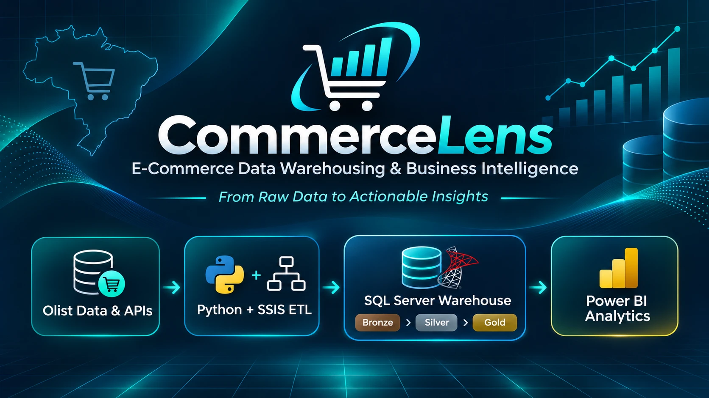
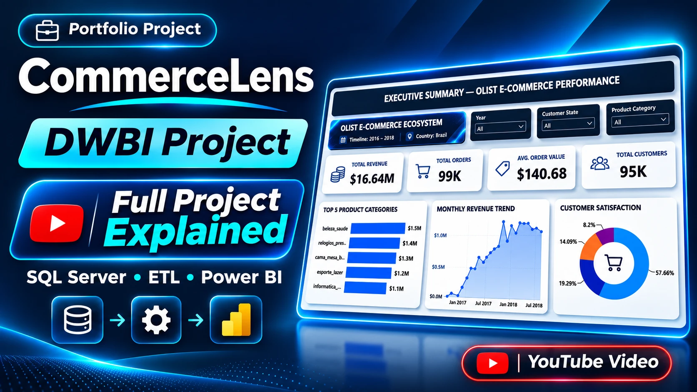
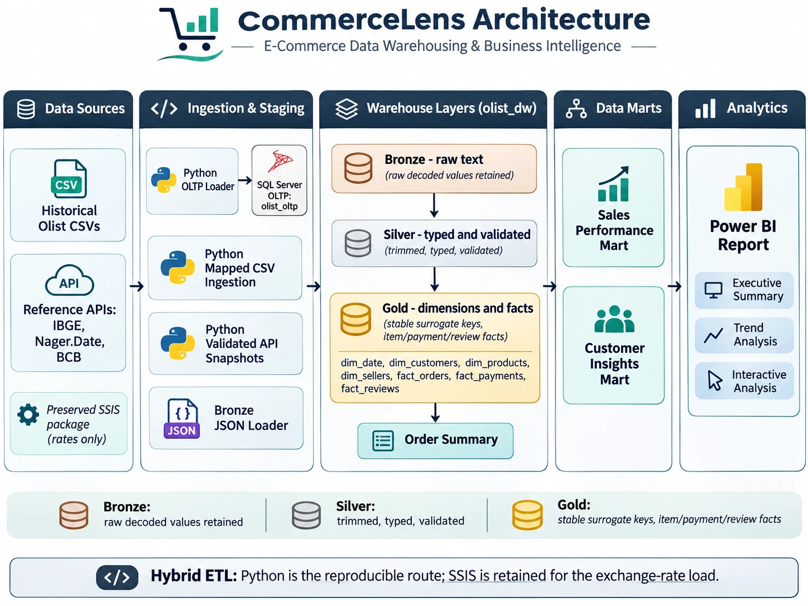
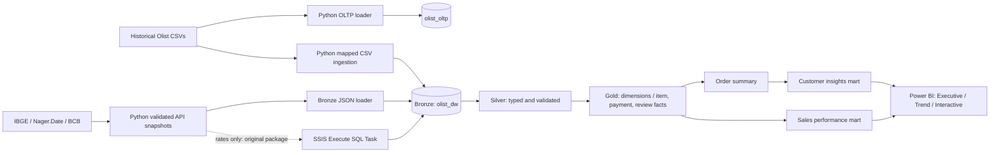
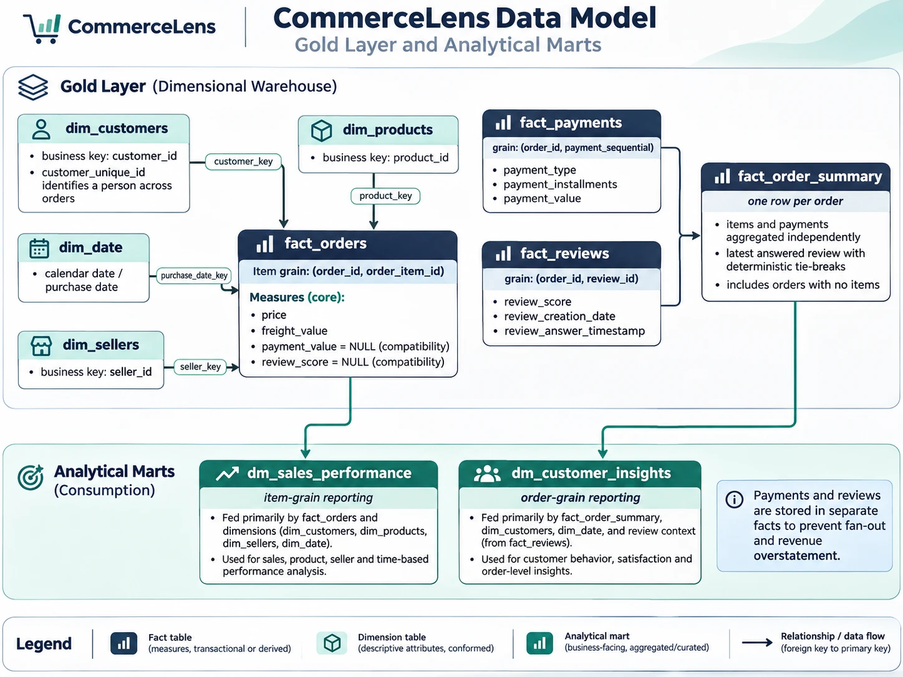
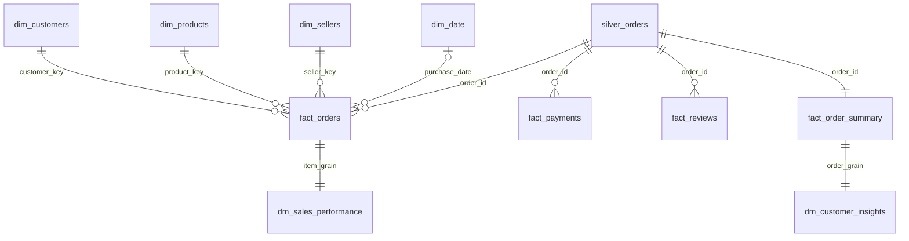
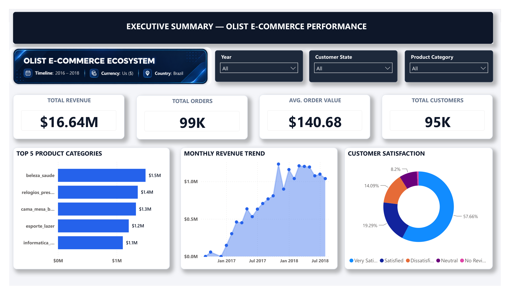
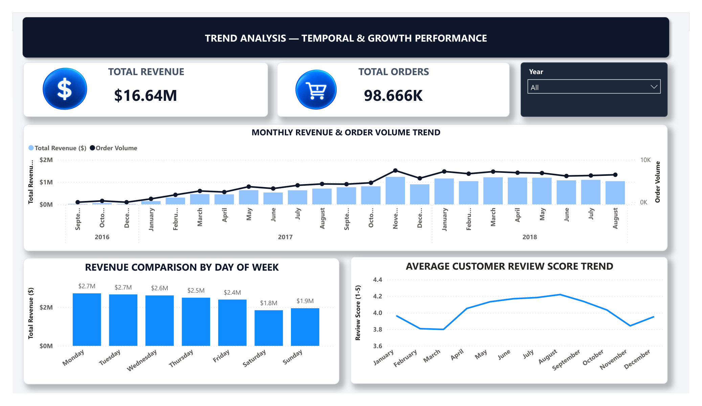
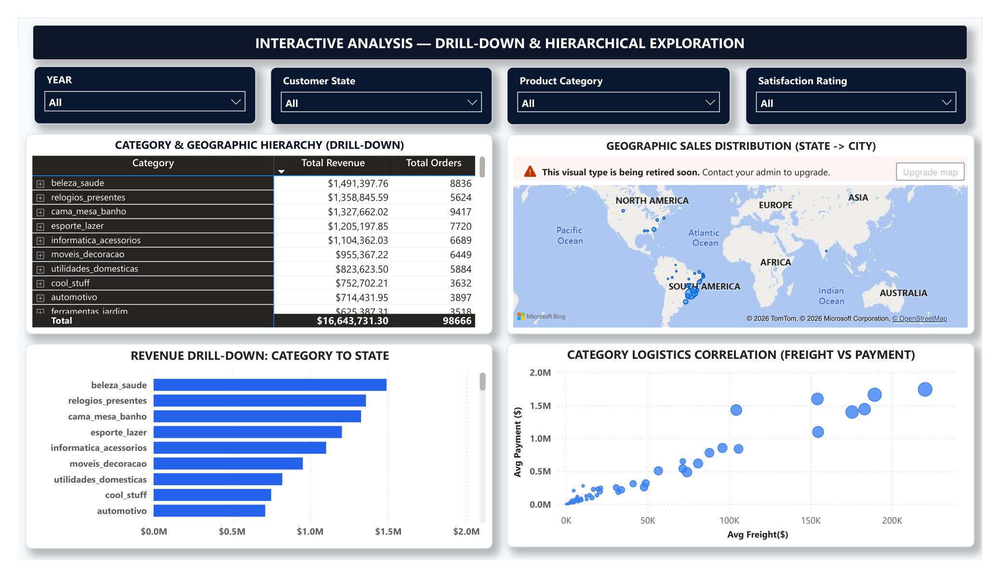

<p align="center">
  
</p>

<p align="center">
  
  
  
  
  
  
</p>

# CommerceLens

**E-Commerce Data Warehousing & Business Intelligence — from raw data to actionable insights.**

CommerceLens is an end-to-end data warehouse and BI solution built on the [Olist Brazilian E-Commerce Public Dataset](https://www.kaggle.com/datasets/olistbr/brazilian-ecommerce). Python and SQL Server transform historical 2016–2018 transactions into a dimensional warehouse (Bronze → Silver → Gold), two analytical data marts, and a three-page Power BI report. The goal is to make sales, freight, payment, customer and service-quality analysis **explainable, reconciled and reproducible**.

The project is a stabilization of the original IT3101 Olist DWBI coursework. The existing SQL Server / SSIS / Power BI architecture, original datasets, report, SSIS package and database identifiers are preserved and remain recoverable.

> **Note:** Read [docs/verification.md](docs/verification.md) before treating any report as refreshed or certified. The preserved `Olist_Ecommerce_Analytics.pbix` holds cached historical results and must not be presented as reconciled just because the database checks pass.

## Demo video

<p align="center">
  <a href="https://youtu.be/fqMp3b7j_TQ">
    
  </a>
</p>

**[Watch the project walkthrough on YouTube (unlisted)](https://youtu.be/fqMp3b7j_TQ)**: architecture, data model, pipeline and the Power BI report.

---

## Table of contents

- [Demo video](#demo-video)
- [Highlights](#highlights)
- [Architecture](#architecture)
- [Data model](#data-model)
- [Tech stack](#tech-stack)
- [Dataset](#dataset)
- [Repository structure](#repository-structure)
- [Getting started](#getting-started)
- [Running the pipeline](#running-the-pipeline)
- [Power BI report](#power-bi-report)
- [Dashboard screenshots](#dashboard-screenshots)
- [Metrics and data quality](#metrics-and-data-quality)
- [Testing and verification](#testing-and-verification)
- [Documentation](#documentation)
- [Limitations](#limitations)
- [Credits](#credits)

---

## Highlights

| Area | What it delivers |
|---|---|
| **Correct grain** | Explicit `(order_id, order_item_id)` item grain; payments and reviews live in their own facts, so order-level payments are never allocated across products. |
| **Reconciled numbers** | The original item/payment/review join produced **118,310** rows against **112,650** true items (BRL 682,055.95 merchandise overstatement). CommerceLens removes that fan-out. |
| **Medallion layers** | Bronze (raw text), Silver (typed and validated), Gold (dimensions, facts, order summary) and data marts. |
| **Safe refreshes** | Transactional full refresh, conversion checks, rollback on error, an ordered SQL runner and an application lock for cooperative runs. |
| **Multiple sources** | Olist CSVs plus public APIs: IBGE (states/regions), Nager.Date (holidays) and BCB (USD/BRL rates). |
| **Hybrid ETL** | Python provides the complete reproducible route; the preserved SSIS package is retained for the exchange-rate load. |
| **BI-ready** | A PBIP project with 16 explicit DAX measures, a date dimension and a custom theme. |
| **Recoverable** | Original source archive and SHA-256 manifest in `docs/baseline/`. |

## Architecture

<p align="center">
  
</p>

The same flow as an editable diagram:



| Layer | Purpose |
|---|---|
| **Bronze** | Decoded source values retained as Unicode text, including empty fields, identifiers and leading-zero ZIP prefixes. |
| **Silver** | Trimmed, typed and validated data. Nonempty values that fail conversion reject the snapshot before replacement; empty dates become `NULL`. |
| **Gold** | Dimensions with stable surrogate keys (Type 1 updates), item / payment / review facts and an order-grain summary. |
| **Data marts** | `dm_sales_performance` (item grain) and `dm_customer_insights` (order grain) feed Power BI. |

Use **one owner per target table per run**. Never run the original SSIS rate writer and the Python API loader concurrently. Full design rationale: [docs/architecture.md](docs/architecture.md).

## Data model

<p align="center">
  
</p>

The same relationships as an editable diagram:



| Table | Grain | Notes |
|---|---|---|
| `fact_orders` | `(order_id, order_item_id)` | Merchandise and freight. Compatibility `payment_value` / `review_score` columns are intentionally `NULL`. |
| `fact_payments` | `(order_id, payment_sequential)` | Installments describe a payment record and do not multiply its amount. |
| `fact_reviews` | `(order_id, review_id)` | Preserves all source review events. |
| `fact_order_summary` | One row per order | Items and payments aggregated independently; latest answered review with deterministic tie-breaks; includes orders with no items. |
| `dim_customers` | `customer_id` | Order-specific ID; `customer_unique_id` identifies a person across orders. |
| `dim_products`, `dim_sellers`, `dim_date` | Business key / calendar date | Stable surrogate keys; the date table covers whole calendar years around all order timestamps. |

See the [data dictionary](docs/data-dictionary.md) for column-level detail.

## Tech stack

| Category | Tools |
|---|---|
| Language and libraries | Python 3.11+, Pandas, Requests, SQLAlchemy, PyODBC, OpenPyXL |
| Warehouse | SQL Server (2016 SP1+, compatibility level 130+; verified on SQL Server 2025 Developer) |
| ETL | Python loaders, SSIS (Visual Studio Integration Services Projects) |
| BI | Power BI Desktop, PBIP / PBIR / TMDL project format, DAX |
| Data sources | Olist CSVs, IBGE, Nager.Date, Banco Central do Brasil (SGS) |

SQL uses `OPENJSON`, `TRY_CONVERT` and `CREATE OR ALTER VIEW`.

## Dataset

The [Brazilian E-Commerce Public Dataset by Olist](https://www.kaggle.com/datasets/olistbr/brazilian-ecommerce) describes historical 2016–2018 activity. It is **not** a live transaction feed. Source CSVs stay under `docs/` to preserve the supplied layout.

| File | Records |
|---|---:|
| Orders | 99,441 |
| Order items | 112,650 |
| Order payments | 103,886 |
| Order reviews | 99,224 |
| Customers | 99,441 |
| Products | 32,951 |
| Sellers | 3,095 |
| Geolocation observations | 1,000,163 |
| Category translations | 71 |

Reference APIs add 27 IBGE state/region records, 42 Brazilian holidays and 750 BCB USD/BRL observations for 2016–2018.

## Repository structure

```text
Commerce-Lense/
├── config/             # .env.example (documented environment variables)
├── data/               # Generated landing / processed artifacts (Git-ignored)
├── docs/               # Guides, source CSVs, baseline archive, verification evidence
│   ├── baseline/       # Original source ZIP, hashes and source contracts
│   ├── images/         # README banner, architecture and data model diagrams
│   └── verification/   # Executed verification snapshots
├── powerbi/            # CommerceLens.pbip, report, semantic model, DAX, theme
├── python/             # Profiling, reconciliation, API fetch, loaders, SQL runner
├── sql/
│   ├── bronze/         # Database and Bronze table initialization
│   ├── silver/         # Bronze → Silver transformations
│   ├── gold/           # Dimensions and facts
│   ├── datamarts/      # Sales performance and customer insight marts
│   ├── migrations/     # Explicit legacy-fact archive
│   └── validation/     # Warehouse assertions
├── ssis/Olist_ETL/     # Preserved SSIS project
├── tests/              # Unit, report-contract and opt-in SQL integration tests
├── requirements.txt
└── requirements-tested.txt
```

## Getting started

Clone the repository and run all commands from its root (the folder that contains `python/`, `sql/` and `powerbi/`).

```powershell
git clone https://github.com/vranasinghe/Commerce-Lense.git
cd Commerce-Lense
```

### Prerequisites

- Python 3.11+ and a matching Microsoft ODBC Driver for SQL Server
- SQL Server 2016 SP1+ with your Windows login granted access
- Power BI Desktop (to open and validate the report)
- Visual Studio with Integration Services Projects (only for editing SSIS)

### 1. Install dependencies

```powershell
python -m venv .venv
.\.venv\Scripts\Activate.ps1
python -m pip install -r requirements.txt
```

### 2. Configure the environment

[config/.env.example](config/.env.example) documents the variables; it is **not** loaded automatically. Export them in PowerShell:

```powershell
$env:OLIST_SQL_SERVER = '.'
$env:OLIST_ODBC_DRIVER = 'ODBC Driver 17 for SQL Server'
# Only if using the legacy SSIS locations:
# $env:OLIST_LANDING_DIR = 'C:\OlistDW\landing'
```

### 3. Initialize the databases

Creates only missing databases and Bronze landing tables. It does not load or cleanse data.

```powershell
sqlcmd -S . -E -C -b -i sql/bronze/initialize.sql
```

`-C` trusts the server certificate for local development. Configure validated certificates for other environments.

## Running the pipeline

```powershell
python python/profile_data.py
python python/reconcile_sources.py
python python/prepare_local_files.py
python python/load_olist.py --target oltp
python python/load_olist.py --target bronze
python python/run_sql.py
python -m unittest discover -s tests -v
sqlcmd -S . -E -C -b -i sql/validation/validate_warehouse.sql
```

`run_sql.py` applies Silver → dimensions → item / payment / review facts → order summary → marts → validation inside one outer SQL transaction. Optional APIs are excluded by default.

**Reference API feeds (optional):**

```powershell
python python/fetch_apis.py
python python/load_api.py
python python/run_sql.py --include-api
```

**Good to know**

- Loading into a populated table requires `--refresh` on `load_olist.py` or `load_api.py`. This authorizes a validated, transactional snapshot replacement.
- Silver and Gold scripts are documented full refreshes; dimensions use Type 1 upserts.
- Back up populated databases before migrating. An existing legacy fact requires the explicit [migration](sql/migrations/001_archive_legacy_fact.sql), which archives rather than drops it.
- On failure, read the last logged script, fix the source / schema / conversion issue, and rerun. See [docs/pipeline-guide.md](docs/pipeline-guide.md).

## Power BI report

Open `powerbi/CommerceLens.pbip` in Power BI Desktop and follow the [Power BI guide](docs/powerbi-guide.md). The project connects to local SQL Server `.` and database `olist_dw`. No credentials are stored in the repository.

| Resource | Link |
|---|---|
| Report file (original, cached results) | [powerbi/Olist_Ecommerce_Analytics.pbix](powerbi/Olist_Ecommerce_Analytics.pbix) (open in Power BI Desktop) |
| Live report (Power BI Service) | _Not published yet. Add the URL here after following [docs/powerbi-publish-guide.md](docs/powerbi-publish-guide.md)._ |
| Dashboard export (PDF, 3 pages) | [docs/Olist_Ecommerce_Analytics.pdf](docs/Olist_Ecommerce_Analytics.pdf) |
| Walkthrough video (unlisted) | [youtu.be/fqMp3b7j_TQ](https://youtu.be/fqMp3b7j_TQ) |

> The `.pbix` holds cached values from the original model. Refresh it against the rebuilt warehouse before presenting its numbers as reconciled.

| Page | Focus |
|---|---|
| **Executive Summary** | Merchandise, orders, customers and order-based AOV. |
| **Trend Analysis** | Merchandise, distinct orders and average rating over time. |
| **Interactive Analysis** | Matrix, map, category comparison, and freight vs. merchandise scatter, with year / state / category / satisfaction slicers. |

The report retains all 31 original visual containers, page names and page order. It adds 16 explicit measures ([CommerceLens.dax](powerbi/CommerceLens.dax)) and an optional [theme](powerbi/CommerceLens.theme.json).

See [Dashboard screenshots](#dashboard-screenshots) below.

## Dashboard screenshots

<p align="center"></p>
<p align="center"></p>
<p align="center"></p>

> **Read before quoting these numbers.** The screenshots come from `powerbi/Olist_Ecommerce_Analytics.pbix` with **no slicers selected** and show cached results from the original model: revenue **$16.64M** and **98,666** orders, labelled in `$`. They are **not** the reconciled warehouse figures (99,441 orders; BRL 13,591,643.70 merchandise; BRL 15,843,553.24 gross; BRL 16,008,872.12 payments, all order statuses, see [Metrics and data quality](#metrics-and-data-quality)). The dataset is in Brazilian reais. Refresh the report against the rebuilt warehouse and replace these images before treating the dashboard values as certified.

| Page | What it shows | Image file |
|---|---|---|
| **Executive Summary** | Revenue, orders, customers and average order value cards, top 5 categories, monthly revenue trend and customer satisfaction split. | `docs/images/dashboard-executive-summary.png` |
| **Trend Analysis** | Monthly revenue and order volume, revenue by day of week and average review score by month. | `docs/images/dashboard-trend-analysis.png` |
| **Interactive Analysis** | Category drill-down table, geographic map, category-to-state revenue and freight vs. payment scatter, with year / state / category / satisfaction slicers. | `docs/images/dashboard-interactive-analysis.png` |

## Metrics and data quality

- **Merchandise** is `SUM(price)` at item grain; **freight** is `SUM(freight_value)`; **gross** is merchandise + freight.
- **Payments** reconcile separately from gross.
- **AOV** is an order-based ratio, never average item price.
- Default reconciliation includes **all** order statuses; delivered-only figures must be explicitly labeled and filtered.

Reconciled source totals (BRL, all statuses):

| Metric | Value |
|---|---:|
| Orders | 99,441 |
| Unique customers | 96,096 |
| Merchandise | 13,591,643.70 |
| Freight | 2,251,909.54 |
| Gross (merchandise + freight) | 15,843,553.24 |
| Payments | 16,008,872.12 |
| Merchandise AOV | 136.68 |
| Latest-review average | 4.09 |

These are source and SQL checks, not claims about unrefreshed visuals. More detail: [data quality](docs/data-quality.md), [data dictionary](docs/data-dictionary.md) and [verification](docs/verification.md).

## Testing and verification

```powershell
python -m unittest discover -s tests -v
```

- 13 automated Python and report-contract tests (loaders, file round trips, API validation, Power BI project integrity). On a fresh clone `test_preserved_original_assets` fails until the SSIS project is built, because it expects a build output under `ssis/Olist_ETL/obj/` that is Git-ignored; the other 12 pass.
- Opt-in SQL integration tests: failure injection with rollback, and NULL-date handling.
- SQL assertions in `sql/validation/validate_warehouse.sql`.
- `dtexec /Validate` on the SSIS package.

Executed results and the list of what was **not** certified are recorded in [docs/verification.md](docs/verification.md).

## Documentation

- [Architecture and grain](docs/architecture.md)
- [Pipeline and recovery](docs/pipeline-guide.md)
- [SSIS implementation](docs/ssis-guide.md)
- [Power BI measures and migration](docs/powerbi-guide.md)
- [Publishing the report to Power BI Service](docs/powerbi-publish-guide.md)
- [Dashboard export (PDF)](docs/Olist_Ecommerce_Analytics.pdf)
- [Data dictionary](docs/data-dictionary.md)
- [Data quality](docs/data-quality.md)
- [Audit and change register](docs/change-report.md)
- [Executed verification](docs/verification.md)
- [Complete delivered tree](docs/project-tree.txt)

## Limitations

- Full refresh is intended for this academic dataset, not concurrent production workloads.
- Existing database schemas must be inspected before reuse; initialization deliberately does not overwrite mismatched tables.
- Original non-Unicode database columns are retained. Migrate their text types explicitly if you need Unicode preservation on an existing deployment.
- The preserved SSIS package executes only the exchange-rate load; its other connection managers are not implemented data flows. See the [SSIS checklist](docs/ssis-guide.md).
- No forecasting, cloud deployment, real-time processing or production SLA is claimed.

## Credits

Data: [Olist](https://www.kaggle.com/datasets/olistbr/brazilian-ecommerce) and the dataset's publishers. Reference data: IBGE, Nager.Date and Banco Central do Brasil. Consult the dataset terms before redistribution. Built as part of the IT3101 DWBI coursework; no new project license or authorship is asserted here.
