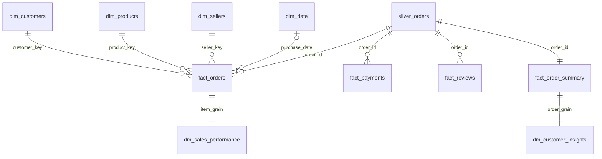

# Architecture and design decisions

Bronze retains decoded CSV values as Unicode text, including empty fields, identifiers and leading-zero ZIP prefixes. Original CSV bytes are preserved separately. Mapped Bronze aliases deliberately match the original Silver SQL. They are a new explicit ingestion contract, not proof that a missing original SSIS data flow produced them.

Silver preserves trimming, state normalization, product `lenght` → `length` mapping, and typed fields. Nonempty values that fail conversion reject the snapshot before replacement. Empty dates become NULL rather than SQL Server's empty-string 1900 conversion. Geolocation preserves all observations; ZIP prefix is not unique. No arbitrary geographic representative is selected.

Gold dimensions retain identity surrogate keys and Type 1 updates; business keys are unique and removed-source members remain for existing facts. Customer grain is `customer_id`, the order-specific customer identifier. `customer_unique_id` identifies a person across orders and is not a dimension uniqueness constraint.

Facts:

- `fact_orders`: `(order_id, order_item_id)`; `order_item_key` is an internal surrogate. Merchandise and freight belong here. Compatibility `payment_value` and `review_score` columns are intentionally NULL and cannot receive allocated or repeated values.
- `fact_payments`: `(order_id, payment_sequential)`; installments describe a payment record and do not multiply its amount.
- `fact_reviews`: `(order_id, review_id)`; preserves all source review events, including review IDs reused across orders.
- `fact_order_summary`: order-grain view. Items and payments are independently aggregated before joining. Review selection orders by answer timestamp DESC, creation timestamp DESC, review ID DESC; SQL NULL timestamps sort last. It includes orders without items or payments.

Unknown purchase timestamps use NULL foreign keys, deliberately retained by LEFT JOIN to date in the sales mart. The date dimension covers whole calendar years around all five order timestamps. Missing customer/product/seller/order references fail the build, so no fabricated business member is needed for the supplied data.

The historical model exposes only two analytical marts and an imported date table plus automatic date tables. Original relationships must be replaced or supplemented deliberately; a shared date field does not create a relationship by itself. See Power BI guide.

SQL scripts initialize missing objects without dropping populated tables. Silver validates temporary staging before transactional delete/insert. The runner wraps all warehouse transformations in one outer transaction and serializes cooperative runs using an application lock. Bronze ingestion is a separate committed snapshot: a failed downstream build leaves the previous warehouse while Bronze can represent a newer source. Retry downstream after correcting the defect; do not interpret cross-layer counts mid-run as a committed reconciliation.
